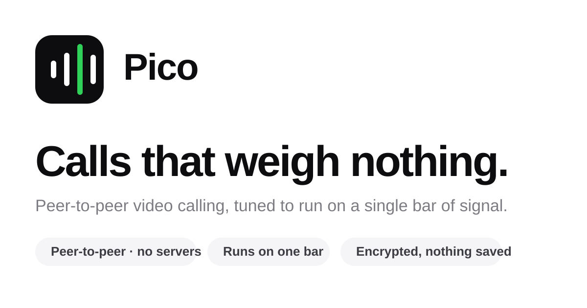

<div align="center">



# onebar

**Calls that weigh nothing.**

Peer-to-peer video calling that sips data, battery and CPU — built to keep the call alive
when the signal drops to one bar.

<a href="https://onebar-teal.vercel.app"></a>


[Quick start](#quick-start) · [How it works](#how-it-works) · [Deploy](#deploy) · [Configuration](#configuration) · [Verification](#verification) · [Deploy guide](DEPLOY.md)

</div>

> **One name to know:** the repo is **onebar**; the product — the mark in the UI and the
> prefix on internal identifiers (`x-pico-version`, `PICO_*`) — is **Pico**. Same app.

---

## What it is

Most "lightweight" call apps still ask you to install something, create an account, and route
every frame of your video through a media server. Pico throws all three away.

Open the page, type a name, press **Start a call**, share the link. Audio and video travel
straight between browsers, encrypted with DTLS-SRTP. The only thing the server ever touches is
kilobytes of signaling: who is in the room, and how the browsers should introduce themselves.

- **No accounts, no downloads, no plugins.** Rooms are links. Names are local.
- **No media server.** Direct peer-to-peer mesh, with TURN as a fallback only for networks where a direct path is impossible.
- **No recording, no storage.** Chat and presence live in RAM for the length of the call.
- **Tuned for bad networks.** Adaptive bitrate, per-peer budgets, receive-side video shedding, and a real `Data Saver` preset at ~90 kbps.

## Features

| | |
| --- | --- |
| **Calls** | Up to 10 people per room · 79-bit room codes · optional passcode gate · instant invite links |
| **Media** | Camera + microphone · screen share with its own bitrate budget · device switching mid-call · "listen together" audio sharing |
| **Quality** | Auto / Data Saver (144p) / Balanced (360p) / Sharp (480p) · live bitrate ladder driven by bandwidth estimation and encoder pressure · Lite mode (audio-only send) |
| **Resilience** | Transient disconnects keep your seat (30 s grace, 120 s rejoin token) · signaling reconnect · one-shot reload when a deploy moves under a long-lived tab |
| **Room** | Host controls (mute one, mute all, remove, lock) · chat with replies, typing indicators, emoji, unread badge · participants and spotlight view |
| **Operations** | Token-gated `/api/health` with TURN allocation counts · anonymized quality telemetry · `?debug=1` overlay · version handshake across signaling and HTTP |
| **Platform** | Installable PWA with an app-shell service worker · security headers and a strict CSP · standalone production build · Docker + Caddy + coturn stack · Vercel WebSocket deployment path |

## Quick start

**Requirements:** Node.js ≥ 22.12 and [Bun](https://bun.sh) 1.3+. Nothing else — no database,
no API keys, no external services.

```bash
git clone https://github.com/Meet547/onebar.git
cd onebar
bun install
bun run dev          # http://localhost:3000
```

`bun run dev` boots Next.js **and** an in-process signaling relay on `127.0.0.1:3003`, which the
app reaches through a same-origin `/signal/` rewrite. There is no second process to babysit.

> Cameras and microphones require a secure origin. `http://localhost` counts; a plain
> `http://192.168.x.x` does not. Put the app behind HTTPS (or a tunnel) to test from other devices.

Production build, locally:

```bash
bun run build        # next build + standalone packaging
bun run start        # node .next/standalone/server.js, PORT=3000 by default
```

## How it works

```
                    ┌──────────────────── one small server ────────────────────┐
   browser A ─────► │  Next.js app  (:3000)                                    │
                    │    ├── /*           landing + call UI                    │
                    │    ├── /signal/*    socket.io signaling  (rewrite → :3003)│
                    │    ├── /info*       room probe           (rewrite → :3004)│
                    │    └── /api/ice     STUN + ephemeral TURN credentials     │
                    │  coturn (:3478)     TURN relay — only when P2P is blocked │
                    └───────────────────────────────────────────────────────────┘

   browser A ◄══════════ DTLS-SRTP media, direct peer-to-peer ══════════► browser B
```

**A call, end to end**

1. **Create or join.** The home screen makes a 16-character room code from `crypto.getRandomValues`
   (≈79 bits) and puts it in the URL; invites are just links.
2. **Pre-join.** Camera, mic and device are chosen before you enter; the preview is the stream the
   engine will later own.
3. **Signal.** The browser opens a socket.io connection to `/signal/` on the same origin and joins
   the room. The relay answers with the peer list, host id, lock state and music state.
4. **Connect.** The engine creates one `RTCPeerConnection` per peer and relays SDP offers/answers/ICE
   through the signaling channel. `/api/ice` supplies STUN servers and, when configured,
   HMAC credentials that expire.
5. **Adapt.** Every peer link reports `getStats()`. The engine keeps a smoothed bandwidth estimate,
   splits the upload budget across peers, steps resolution → frame rate → audio-only under pressure,
   and restores quality when the link recovers. Unwatched tiles are not encoded at all: viewers
   announce which peers they are actually looking at.
6. **Leave.** An explicit leave is immediate. A dropped transport is treated as a reconnect: the
   peer is marked *reconnecting*, and its private rejoin token restores the same seat without
   reshuffling host duties.

**Mesh math.** With *n* participants every browser holds *n−1* connections — 45 bidirectional
links at the 10-person cap, 90 `RTCPeerConnection` objects in total. Upload and encode cost scale
with peer count, which is why the limit is 10 and why the video-interest and budget logic exist.
The full analysis, including measured per-preset bitrates, is in [SCALING.md](SCALING.md).

## Deploy

### One VPS, batteries included

`docker-compose.yml` runs the whole production shape: the Next.js app, the signaling relay as its
own supervised container, coturn for TURN, and Caddy for automatic HTTPS.

```bash
git clone https://github.com/Meet547/onebar.git && cd onebar
cp deploy/.env.example .env        # fill in PICO_DOMAIN, TURN_SECRET, TURN_PUBLIC_IP
PICO_VERSION=$(git rev-parse --short HEAD) docker compose up -d --build
bash scripts/check-live.sh call.example.com "$HEALTH_TOKEN"
```

On a fresh Ubuntu box, `scripts/deploy.sh` automates the same path — Docker install, secrets,
sysctl and firewall rules, build, healthchecks, live gate — and `scripts/rollback.sh` rolls back
using `.deploy-history`. Ports, TURN-over-TLS, certificate renewal and troubleshooting are covered
in **[DEPLOY.md](DEPLOY.md)**.

### Vercel

The app deploys as-is; signaling uses a WebSocket function at `/api/signal` and room state lives in
Redis (`REDIS_URL`, e.g. an Upstash database). The Vercel path does **not** ship TURN: `/api/ice`
advertises STUN only until `TURN_URLS` and valid credentials are configured, so users behind
symmetric NATs may not connect. Verify a deployment with:

```bash
node scripts/smoke-vercel-relay.mjs https://your-app.vercel.app
```

## Configuration

Everything is optional for local development. Client-side values are inlined at **build** time;
the rest is read at runtime.

**Build time**

| Variable | Default | Purpose |
| --- | --- | --- |
| `PICO_VERSION` | git short SHA → `package.json` | Deployment identity: `x-pico-version` header, socket handshake, service-worker caches, `/api/health` |
| `NEXT_PUBLIC_SITE_URL` | `VERCEL_URL` → `http://localhost:3000` | Canonical origin for metadata, OG images and the signaling origin allowlist |
| `NEXT_PUBLIC_SIGNALING_URL` | same origin | Set only when signaling lives on another host |
| `NEXT_PUBLIC_SOCKET_PATH` | `/signal/` (`/socket.io` in Docker) | Signaling path |
| `NEXT_PUBLIC_ROOM_INFO_URL` | `/info` (`/api/room-info` on Vercel) | Room probe endpoint |
| `NEXT_PUBLIC_TELEMETRY` | enabled | Set to `0` to stop the client's anonymized quality POSTs |

**Runtime — ICE / TURN**

| Variable | Purpose |
| --- | --- |
| `TURN_URLS` | Comma-separated TURN URLs; unset means STUN-only (logged once a minute) |
| `TURN_SECRET` | coturn REST secret → time-limited HMAC credentials (preferred over static credentials) |
| `TURN_USERNAME` / `TURN_CREDENTIAL` | Static credentials (fallback when `TURN_SECRET` is unset) |
| `TURN_CREDENTIAL_TTL` | Lifetime of ephemeral credentials, seconds (default 21 600, clamped 300–86 400) |
| `TURN_TLS_HOST` / `TURN_TLS_PORT` / `TURN_TLS_443` | `turns:` fallback for firewalls that only allow TLS; `TURN_TLS_443=0` disables it |
| `TURN_STATS_FILE` | coturn stats JSON used by the token-gated `/api/health` |

**Runtime — server / signaling**

| Variable | Purpose |
| --- | --- |
| `HEALTH_TOKEN` | Enables TURN statistics and the `/api/quality` dump. Fails closed: unset means those sections are never served |
| `PICO_EMBEDDED_RELAY` | `0` disables the in-process relay (the Docker stack runs its own) |
| `RELAY_HOST` / `RELAY_PORT` / `RELAY_INFO_PORT` | Embedded relay bind address and ports (default `127.0.0.1:3003` / `:3004`) |
| `RELAY_UPSTREAM` / `INFO_UPSTREAM` | Where the Next.js rewrites forward `/signal/*` and `/info*` |
| `ORIGIN` | Extra comma-separated origins allowed to open signaling sockets (same-origin always passes) |
| `REDIS_URL` | Required only for the Vercel relay (`/api/signal`, `/api/room-info`) |
| `DATABASE_URL` | Prisma/SQLite scaffolding only — the call path never touches a database |

## Commands

| Command | What it does |
| --- | --- |
| `bun run dev` | Dev server on :3000 with the embedded relay |
| `bun run build` | Production build + standalone packaging (fails on type errors) |
| `bun run start` | Run the packaged standalone server |
| `bun run lint` | ESLint |
| `bun run typecheck` | `tsc --noEmit` |
| `bun run test:unit` | Version/field-report and adaptive-bitrate assertion suites |
| `bun run test:server` | API and request-body unit tests (`bun test`) |
| `bun run test:signaling` | Two-peer signaling E2E through the real `/signal/` rewrite — needs a running app |
| `bun run test:meeting` | 10-browser fake-device load test with real `getStats()` — needs Chromium |
| `bun run test:security` | Relay hardening checks |
| `bun run test:site` | Live deployment smoke test |
| `bun run db:generate` / `db:push` / `db:migrate` | Prisma scaffolding (not used by the call runtime) |
| `node scripts/gen-assets.mjs` | Regenerate PWA icons and the social card |

## Verification

Measured in this checkout:

| Check | Result |
| --- | --- |
| `typecheck` + `lint` | Clean, no errors or warnings |
| `test:unit` | **81 assertions passed** — 23 version/field-report, 58 adaptive bitrate |
| `test:server` | **10/10 passed** — bounded telemetry intake, UTF-8 byte accounting, streaming size caps |
| `test:signaling` | **19/19 passed** against a standalone production server — connect, version handshake, join/ack, SDP + ICE relay, state, chat + typing, host mute/lock, locked-room rejection, reconnecting/rejoin, peer:left |
| Standalone server | Landing page, `/api/health`, `/api/ice`, `/info`, PWA assets and manifest all answered 200; browser console clean |
| `bun run build` | Compiles, type-checks and produces the standalone bundle |

The project's larger evidence — a 10-participant, 90-connection loopback run with real WebRTC
counters — lives in [LOCAL-VERIFICATION.md](LOCAL-VERIFICATION.md). Loopback and fake devices are
not a capacity claim; the gaps are listed there and in [SCALING.md](SCALING.md).

## Project structure

```
src/
  app/                  App Router: landing page, error boundary, API routes
  components/call/      home, prejoin, room, tiles, panels, debug overlay
  components/ui/        UI primitives
  lib/call/             engine (WebRTC mesh), adaptive bitrate, signaling socket, store, music
  lib/relay-server.ts   In-process socket.io signaling relay
  lib/vercel-relay.ts   Redis-backed relay for the Vercel WebSocket function
  lib/ensure-relay.ts   Keeper that probes and revives the embedded relay
  instrumentation.ts    Boots the relay with the server process
deploy/                 Caddy, coturn, standalone image, full env template
mini-services/signaling Standalone relay used by the Docker topology
scripts/                Deploy, rollback, live checks, load tests, asset generation
public/                 PWA manifest, service worker, icons, social card
tests/                  Server unit tests and runtime build checks
```

## Privacy and security model

- **Media never touches the server.** It is DTLS-SRTP encrypted in the browser and travels
  peer-to-peer. TURN, when used, relays ciphertext.
- **Signaling is same-origin only.** The relay's engine.io `allowRequest` compares `Origin` with
  `x-forwarded-host` / `Host` (or an explicit allowlist) and fails closed.
- **Passcodes are a gate, not the encryption.** Only a SHA-256 hash is held in memory — never
  logged or stored — and ten wrong attempts earn a 60-second cooldown. Room codes are random
  bearer credentials: treat an invite link like a key.
- **Room powers are enforced server-side.** Only the host socket can mute, remove or lock.
- **Hardened endpoints.** Every socket event is rate-limited, SDP is capped at 20 KB, chat at 500
  characters, the socket buffer at 100 KB. HTTP responses carry CSP, `X-Frame-Options: DENY`,
  `nosniff`, `Referrer-Policy: no-referrer` and a restrictive `Permissions-Policy`.
- **Observability is opt-in.** `HEALTH_TOKEN` gates TURN statistics and quality dumps; without it
  they are not served at all. Quality telemetry carries numbers only — no ids, room codes, IPs or
  user agent — and can be compiled out with `NEXT_PUBLIC_TELEMETRY=0`.
- **Nothing is recorded.** No recordings, transcripts, messages or call metadata are stored.

## Limits, stated plainly

- **10 participants, because it is a mesh.** There is no SFU: each browser encodes for every peer.
  Past ten, CPU and upload become the bottleneck. [SCALING.md](SCALING.md) has the numbers.
- **TURN is required for some networks.** Without it, users behind symmetric NATs or strict
  firewalls will sit on "Connecting…". The Docker stack ships coturn; the Vercel path does not.
- **Loopback tests are not production guarantees.** Results in this repo come from one machine
  with fake camera devices — real networks, low-end phones, thermals and battery are untested here.
- **No persistence by design.** Restarting the app loses rooms and chat; there is no account system
  to recover anything from.
- **Not built (yet):** recordings, transcripts, scheduling, an SFU mode, and E2EE beyond the
  browser's DTLS-SRTP.

## Docs

| Document | What's inside |
| --- | --- |
| [DEPLOY.md](DEPLOY.md) | Vercel and single-VPS deployment, TURN/TLS, certificates, operations, troubleshooting |
| [SCALING.md](SCALING.md) | Mesh math, per-preset bitrate budgets, what the numbers do and do not prove |
| [LOCAL-VERIFICATION.md](LOCAL-VERIFICATION.md) | The 10-participant run, CPU/RSS measurements, remaining release gates |
| [AGENTS.md](AGENTS.md) | Notes for coding agents working in this repo |

## Contributing

Issues and pull requests are welcome. Before opening a PR, run `bun run typecheck`,
`bun run lint`, `bun run test:unit` and `bun run test:server`; if you touched signaling, also run
`bun run test:signaling` against a local production server.

## License

There is no `LICENSE` file in this repository yet, so the code is public but not formally
licensed. Add one (MIT or Apache-2.0 are the usual choices) before distributing it or accepting
outside contributions.
